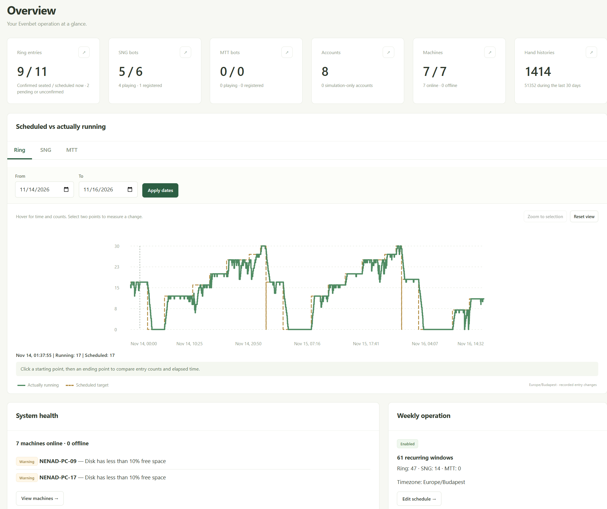
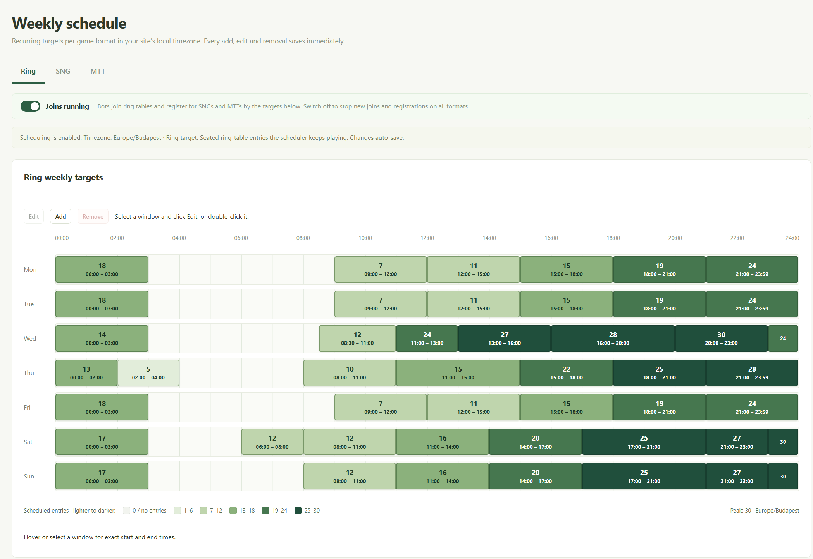
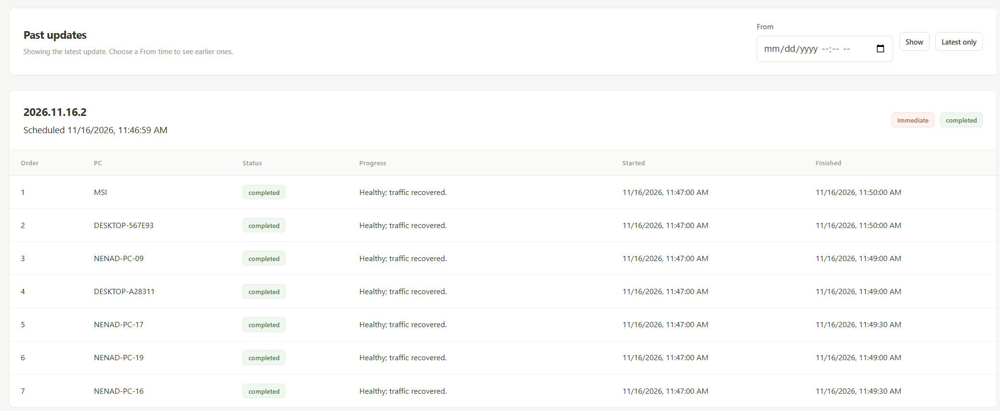

# ScheduleController | Distributed scheduling

> **Permitted use:** These bots may only be used for research, poker practice in the [simulator](https://github.com/biresevit/simulator-portfolio), poker practice through a real poker-site client, or authorized load testing to assess a poker site's stability under high traffic. Running bots at real-money tables without disclosing their use to all human players is prohibited.

A Python service that translates weekly operating targets into coordinated work across multiple machines. Planning runs in Azure; local workers execute commands and report observed state.

## Engineering highlights

- Timezone-aware planning with daylight-saving transitions, capacity constraints, and gradual joins and departures.
- Transactional commands, account leases, worker epoch fencing, heartbeat expiry, and restart reconciliation.
- Idempotent hand-history ingestion, SQL reporting, and simulation tools.

**Technology:** Python 3.11, Azure Functions, Azure SQL, Blob Storage, pytest.

## Platform architecture

```text
PokerBackoffice -> Azure SQL <- ScheduleController (Azure Functions)
                                     | commands / telemetry
                                PokerController
                                     | REST
                                  PDecision
                                     |
                         simulator / DecisionMaking
```

[PokerBackoffice](https://github.com/biresevit/PokerBackoffice) | [ScheduleController](https://github.com/biresevit/ScheduleController) | [PokerController](https://github.com/biresevit/PokerController) | [PDecision](https://github.com/biresevit/PDecision-portfolio) | [simulator](https://github.com/biresevit/simulator-portfolio)

## Product view



The companion PokerBackoffice dashboard visualizes the output of this scheduling backend: the scheduled target against what actually ran.

The input is a weekly schedule of hour-by-hour targets, which the planner turns into join and leave commands for the PCs.



The same scheduler orders software updates on the PCs and tracks each machine until it is healthy and its traffic has recovered.



## Setup and operations

A full deployment requires configured infrastructure, platform accounts, and companion components. The following sections describe setup, validation, and operational requirements.

**Deploying:** see `../PokerBackoffice/docs/deploy.md`. Files in `schedule_controller` ship in different places (scheduler function, backoffice bundle or PC release); its section 1 lists which.

Python foundation for customer-scoped poker scheduling. The complete design is in [SPECIFICATION.md](SPECIFICATION.md).

The first environment is one customer on one poker site, with eight verified demo accounts. The transactional planner is deployed as the Flex Consumption Function `poker-schedule-controller`; poker connections remain on the assigned PokerController machines.

## Implemented

- Weekly local-time schedule evaluation, including DST and midnight accounting.
- Currency-specific stake bands, exact integer target allocation, and strict category matching.
- A pure preview planner with gradual joins/departures, machine capacity and table concentration, account-to-machine ownership, pending reservation accounting, soft daily preference fallback, and stale observation handling.
- Azure SQL migration and customer/site/account seed with transactional dry run, migration checksums, idempotency and ownership checks.
- SQL structures for future telemetry, leases, commands, outbox and daily time accounting. The presence of these tables does not imply their writers/consumers exist yet.
- A 30-second Azure timer that plans joins/leaves transactionally under a per-site SQL lock.
- A separate 30-second Azure ingestion timer that reads each new customer hand-history blob once, persists per-player invested/won/net amounts, records human counts and automatically backfills older hands. SQL leases, parser versions and unique result keys make retries idempotent.
- A fenced local PokerController worker that claims due commands, publishes lobby/live telemetry, and performs the existing poker-site/PDecision lifecycle.

## Remaining implementation

1. Durable secret/credential references instead of the current authorized demo-account convention.
2. Coordinated in-session breaks and longer multi-account load testing.
3. Cloud-side lobby observation; currently lobby scanning is part of PokerController while planning is fully in Azure.

On restart, the worker fences the stale machine epoch, logs in only affected accounts, proves every prior table seat against the poker site, adopts seats that still exist and closes only confirmed-absent entries. The machine remains unavailable to the scheduler until reconciliation is complete.

Scheduling for the first environment remains disabled until PDecision and the PokerController worker are online. Enabling a schedule without a ready machine creates no joins.

## Local setup

```powershell
python -m venv .venv
.\.venv\Scripts\python.exe -m pip install -e '.[test,db]'
.\.venv\Scripts\python.exe -m pytest -q
```

`tzdata` supplies IANA timezones on Windows. Database conversion selects ODBC Driver 17 on this Windows PC and Driver 18 in the Linux Azure Function.

## Azure deployment

The Function App `poker-schedule-controller` is in resource group `poker-backoffice`, uses Flex Consumption (512 MB, maximum two instances), and fires every 30 seconds. It has a dedicated least-privilege SQL user and no poker credentials. Application Insights records each tick. With the site disabled, a healthy tick reports `Scheduler tick completed: []`.

Updates that interrupt active sessions remain serial per customer. New PCs and ready, idle PCs with no open entries or sessions install independently, including alongside another PC's resource sync. The scheduler fences an idle PC from new assignments before downloading and rechecks its journal before installation. Pending and uncertain entries prevent this bypass. An explicit pause still stops its own rollout; other idle PCs may proceed. Installed versions and controller health are verified before restoring scheduling.

Machine activity expires after three minutes without a heartbeat, including when site scheduling is disabled. The timer closes entries and account sessions at the heartbeat deadline, expires outstanding commands, and fences the old worker epoch. Account leases require live reconciliation before reuse. Customer-scoped backoffice reads apply heartbeat expiry through reporting views without changing the journal. The timer owns cleanup writes, keeping website reads from blocking workers.

The same app runs `hand_history_results_tick` at seconds 15 and 45. It has read-only access to the hand-history container and write access only to `reporting.HandProcessing` and `reporting.HandPlayerResult`. It never opens poker connections. Failed parses are retained with bounded error text and retried at most five times; reporting excludes incomplete and historical bot-only hands.

Only these processes run on the poker machine:

```powershell
# Start PDecision first, then:
cd <path to PokerController>
.\.venv\Scripts\python.exe -m poker_controller.worker --output artifacts\azure-worker
```

The worker reads the existing user-level `SqlConnectionString`. It does not run the planner locally.

## Database migration

Use `SCHEDULE_SQL_CONNECTION_STRING` for a native ODBC connection string or the existing `SqlConnectionString` environment variable for the standard ADO.NET form. Never put credentials in a file committed to the project.

```powershell
# Execute migration/seed inside a rollback transaction and report the result.
.\.venv\Scripts\python.exe -m schedule_controller.database --seed-nenad --machine-id 1

# Apply the validated migration and seed. Repeating this preserves custom policies.
.\.venv\Scripts\python.exe -m schedule_controller.database --seed-nenad --machine-id 1 --apply
```

The seed only reassigns the specifically selected active machine when its current customer is `Internal (Nenad dev)` or already `Nenad`. Other customer/site registrations are rejected. Existing hand histories are not moved. PDecision reads the new registration at its next startup.

Nenad's site starts with scheduling disabled, no weekly targets, one disabled machine assignment capped at six entries, and disabled account policies awaiting worker provisioning. The existing demo account stays an active dbo.BotAccount. The five synthetic demo accounts are inactive in dbo.BotAccount and marked synthetic in scheduler.AccountPolicy. A SQL constraint prevents enabling synthetic policies or attaching credentials. They are usable only in explicit offline simulations.

Migrations are immutable after application. Add `002_*.sql` for future schema changes. `scheduler.SetSchedule` atomically replaces a site's windows and rejects overlaps; use a configuration API with customer authorization before exposing it to workers/customers. Direct SQL access is for provisioning only.

## Tests and simulation

```powershell
# Pure tests; no Azure writes or poker activity.
.\.venv\Scripts\python.exe -m pytest -q

# SQL constraints, idempotency and schedule validation. Every test rolls back.
$env:SCHEDULE_SQL_TEST='1'
$env:SCHEDULE_TEST_MACHINE_ID='1'
.\.venv\Scripts\python.exe -m pytest -q
Remove-Item Env:SCHEDULE_SQL_TEST

# Demonstrate 45 occupied entries converging toward 56, without DB/network calls.
.\.venv\Scripts\python.exe -m schedule_controller.simulate

# Read back the deployed Nenad configuration; no mutations.
.\.venv\Scripts\python.exe -m schedule_controller.verify
```

The first migration and Nenad seed were validated against Azure SQL in rollback transactions before application. Unit coverage includes the 56/45 scenario, repeated triggers, duplicate seat prevention, unknown observations, category/currency boundaries, synthetic blocking, empty-table starts, full seat usage, capacity, daily preference fallback, DST, account provisioning, and buy-in feasibility. See [VALIDATION.md](VALIDATION.md) for the recorded result.

### Traffic pacing

The first environment uses gaps of 45 to 285 seconds for joins and leaves. The planner mixes short gaps and longer pauses using a beta distribution, and queues the next change only once the previous change is within one scheduler tick. Ten-entry increases or decreases typically take about 30 minutes; this is a stochastic target rather than a completion deadline. Availability, failed joins, cooldowns and finishing hands can extend it. Existing queued commands keep their due times. Other sites keep their configured gap limits.

The simulator uses the same gap distribution and 30-second scheduler ticks. Session-expiry departures also pass through the planner's pacing instead of leaving all tables at once.
