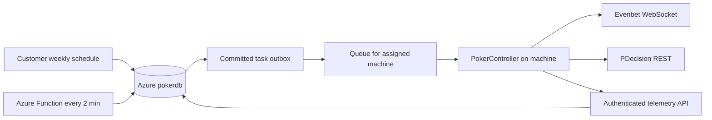

# Customer poker scheduling

Status: implementation specification, 2026-10-26. Initial rollout is **Nenad / Evenbet** with Monica and five synthetic database accounts. Simo / BluffPoker is outside this rollout.

## Responsibilities and deployment

Use Python 3.11+ for the new ScheduleController and the existing PokerController. PDecision stays in C# and continues to provide decisions and hand-history processing through REST.

ScheduleController is a short Azure Function with a UTC timer every 30 seconds (`*/30 * * * * *`). It reads current state, computes the desired change, and commits a small number of durable tasks. The invocation interval is independent from the planning horizon: one invocation may create several idempotent commands with `NotBeforeUtc` values spread across the following two minutes, so human-like 10–60 second gaps do not require one Function invocation per join. It does not hold poker WebSockets or wait for players to finish hands. PokerController remains a continuously running process on each assigned machine and owns login sessions, tables, decisions, breaks, and telemetry.

Lobby observation is platform-capability based. `CloudProtocol` sites such as Evenbet may be scanned by a short-lived Azure observer before planning; `MachineProtocol` and `MachineUi` sites publish their normalized snapshots from an assigned machine; `Disabled` sites cannot receive new joins without another fresh source. Baseline lobby scans and interactive Live Tables scans have separate intervals and leases. The scheduler consumes the same `LobbyTable`/`TableSeat` records regardless of source and never creates a join from stale data.

Prefer Azure Functions Flex Consumption on-demand without always-ready instances for this workload. One two-minute timer is approximately 21,600 invocations per 30 days, plus telemetry/API invocations if those endpoints are hosted as Functions. This is not a promise of zero cost: SQL, storage, network, logging, function duration, and other apps sharing the subscription also matter. An existing always-on VM can run the same scheduler loop for development, but a new VM solely for this small periodic job is unnecessary.

Use a timer even if event-triggered reconciliation is added later. A deficit can appear at a schedule boundary or because a heartbeat becomes stale without any database row changing. An Azure SQL trigger observes changes by polling; it does not directly trigger on `actual < desired`. Optional coalesced events can request an earlier pass after a worker leaves or a schedule changes.

Use **Azure Storage Queue per machine** for command notification initially, backed by an authoritative SQL task ledger and an outbox. This fits the low-volume command workload and avoids a new Service Bus Standard base charge. Queue names include customer site and machine IDs. If an existing Service Bus namespace is already paid for, a dedicated queue per machine is a suitable alternative. Do not share queues with solver requests. Service Bus sessions offer routing/ordering but do not replace SQL claims or prevent a worker with broad queue access from selecting another machine's session.

Both queue choices allow redelivery. A notification only identifies a task; executing it twice must have no additional effect. No account password, connection string, or decision state belongs in queue messages. Polling an authenticated tasks endpoint can serve as a recovery path if a notification is lost.

## Terms and counting rules

An **entry** is one account seated at one table. Fifty accounts playing one table plus one account playing six tables equals 56 entries. An account may have several entries on the same machine; one account must never be logged in from two machines concurrently.

Track confirmed seated entries, playing entries, sitting-out entries, pending joins, pending leaves, and uncertain entries separately. The schedule targets **occupied bot seats**. Brief breaks retain their seat and count toward the target, avoiding replacement bots being added during a break. A separate playing counter shows how many are actively available to receive cards.

Projected occupancy is the union of observed owned account/table pairs and unresolved reserved entries, minus confirmed/planned departures when calculating further departures. A seat appearing in telemetry while its join command is still pending is counted once. Pending joins consume account, table, and machine capacity immediately. A pending leave does not free capacity for a replacement until leaving is confirmed.

The planner must use fresh worker and table observations. Never interpret missing telemetry as an empty table. Stale/uncertain entries retain reservations until reconciliation establishes the actual server state. Show a shortfall reason instead of blindly replacing uncertain sessions.

Lobby occupancy is a current server snapshot. It is separate from the hand-scoped participant state sent to PDecision; joining or leaving mid-hand must not change the frozen hand participants.

## Customer and site scope

Reuse `dbo.Customer`, `dbo.CustomerMachine`, and `dbo.BotAccount`. Add tables under schema `scheduler`. `Site` joins a CustomerId with the existing EnumCasino name and specifies the platform adapter, endpoint, timezone, currency, and controller settings. Avoid copying EnumCasino numeric values into a new independent enum. Existing bot identities remain unique by Casino + Username.

`AccountPolicy` assigns each BotAccountId to exactly one SiteId. No shared ownership. A site's casino must match the account's casino; an assigned machine's customer/casino must match its existing registration. Only accounts in that customer's site may be scheduled, queried, or configured by its worker identity. PDecision's casino-wide list may still identify other known bots, but it is not a scheduling ownership list.

The initial migration creates Nenad, its Evenbet site, and policies for Monica plus five clearly named synthetic accounts. It reassigns this PC's existing Evenbet registration to Nenad so future hand histories have the same customer as the schedule. Existing hand-history rows retain their original customer. Synthetic identities have no real poker credentials, are disabled in dbo.BotAccount, and cannot execute live login tasks. No Simo records are reassigned.

## Weekly schedule

Each site has an IANA timezone, initially `Europe/Budapest`. Persist instants in UTC. Resolve weekday/time through that timezone during every pass, including daylight-saving transitions; do not convert the whole weekly schedule to fixed UTC offsets.

Windows use Monday=0 through Sunday=6, start minute inclusive, end minute exclusive, and nonnegative integer TargetEntries. Example Tuesday 10:00–11:00: weekday 1, start 600, end 660, target 56. No overlapping windows. Overnight intervals are split into two day rows. Missing windows mean target zero. Repeated fall-back hours use the same local target; nonexistent spring-forward times never become active. Elapsed playtime is measured by UTC durations, not wall-clock subtraction.

Schedule changes are atomic and versioned. Disable scheduling to pause task creation while retaining existing sessions; set the current target to zero or issue a drain to leave tables. These are different operations. Initial sites are disabled with no schedule until a real test schedule is supplied; the example 56 is a test fixture, not a production instruction.

## Stakes

Stake values refer to the **amount of the big blind in the table currency**, not a multiple of the blind. Store money with decimal precision and retain currency IDs/precision from the adapter. Never compare different currencies as though their amounts were interchangeable.

Nenad / Evenbet defaults:

| Category | Big blind interval | Target percentage |
| --- | --- | --- |
| Low | 0.02 <= BB < 0.5 | 33.34% |
| Medium | 0.5 <= BB < 1 | 33.33% |
| High | 1 <= BB <= 4 | 33.33% |

Bands are editable per site, disjoint, and percentages total exactly 100%. Integer per-category targets use largest-remainder allocation so they sum to the schedule target. Each account has one persistent category, assigned evenly by default. A low-stake account never moves into medium/high to fill a shortfall. Exclude tables outside configured bands and currencies. Initially do not borrow an unavailable category's target into another category; report the deficit. The settings can be extended to support an explicitly chosen redistribution policy later.

## Table and machine selection

Support cash NLH and PLO4 initially. Table selection uses supported game/format, configured stake band, currency, minimum/maximum buy-in, available seats, account eligibility, and observation freshness. **Do not use human presence, human counts, or the bot/human ratio to rank or reject tables.** Bots may open empty tables, and no seat is reserved specifically for a human.

Do use the number of entries from each machine on a table to limit simultaneous disruption when a machine fails. For each candidate account/table/machine combination:

1. Reject offline/unready machines, stale tables, full tables, duplicate account/table seats, missing credentials, synthetic accounts in live mode, incompatible account stakes, and exhausted hard capacity.
2. An already logged-in account is pinned to its current machine. Consider other accounts on other machines rather than migrating its active session to improve balancing.
3. Prefer populated tables probabilistically rather than deterministically: weight selection upward with total occupancy so active tables are chosen more often than empty tables. Counterweight that score by same-machine concentration and machine utilization, limiting simultaneous disruption if one machine fails. Include pending reservations in every comparison. Never use whether those occupants are humans or bots.
4. Among otherwise eligible accounts, first consider accounts below their daily playtime preference. Weight selection by playing frequency and by less playtime already used. If all available accounts exceed the preference, select the least-played eligible accounts, with frequency used to break ties. Hard capacity, ownership, stake, credential, and site constraints are never relaxed.

Store MaxEntries per machine and MaxTables per account (initially six, editable). Six is an initial conservative setting, not a measured machine capacity. Worker health includes PDecision readiness and the site's connection state; merely having a recent OS heartbeat is insufficient.

## Gradual convergence and session rotation

Do not emit the whole 11-entry deficit in the 56-versus-45 example. Start with at most three joins per two-minute pass, separated by randomized 20–60-second gaps and persisted NotBeforeUtc times. The same configurable rate limit applies to departures. Persist NextJoinUtc/NextLeaveUtc and LastReconciledUtc under the site lock so duplicate/early triggers cannot bypass pacing or the per-pass budget. Preserve future reservations across ticks. Reconcile current target before a queued task executes; cancel obsolete joins when demand drops. If faster event-driven evaluation is introduced, separate its cancellation path from the join rate budget.

If occupancy is above target, cancel unstarted joins first, then choose departures gradually, prioritizing longer sessions and accounts above their preferred daily playtime. Workers finish the current hand and leave at a safe boundary. A drain deadline is observable; never silently force a monetary action to accelerate leaving. A reconnect or uncertain purchase does not justify buying in again.

MaxPlaytimeMinutes is a **soft daily preference**, following the user's requirement to favor the schedule when no under-limit accounts are available. Under a constant target, rotate an over-limit account out only when an eligible replacement exists; drain then replace so hard seat/machine limits are preserved. Include a minimum session length/cooldown to avoid frequent swaps. Report soft-limit overrides explicitly.

## Per-account defaults and behavior

Defaults are generated once and stored. Refresh settings at startup and every ten minutes; do not redraw them on each refresh or overwrite user edits during CSV imports. A configuration version activates atomically. Failed refreshes retain the last valid settings. Commands, heartbeat, and leases have shorter clocks and must not wait ten minutes.

Frequency categories low/medium/high are distributed evenly within a site with weights 1/2/4. Assign daily preferences of 120/240/360 minutes evenly and independently of frequency and stakes. A user simultaneously playing six tables for one hour has 60 session minutes and 360 entry-minutes. Keep both counters; daily account preference uses the former. Sitting-out time while retaining seats counts toward the session preference. Split intervals at site-local midnight, compute interval durations in UTC, and avoid counting overlapping table sessions multiple times. Server-observed lease/heartbeat intervals provide accounting after a crash; do not count unobserved offline hours as playtime.

Strategies 5–8 are strong (Strong Balanced/Tight/Loose/Mix); 1–4 are fish profiles from the existing CSV mapping. Unknown/custom profiles require an explicit classification.

| Setting | Strong defaults | Fish defaults |
| --- | --- | --- |
| PostBbChance | Uniform persisted value 0–0.2 | Uniform persisted value 0–1 |
| RunItTwiceChance | Uniform persisted value 0.8–1 | Uniform persisted value 0–1 |
| Buy-in | 65% 100 BB, 20% 200 BB, 5% each 20/30/40 BB | 55% 100 BB, 15% 200 BB, 25% divided over 20/30/40/50 BB, 5% irregular 41–99 BB excluding multiples of 10 |

Use the configured distribution for each new entry and persist the chosen amount with the command so retries cannot change it. Filter infeasible buy-in choices against table limits and available funds, renormalize the remaining weights, and round to the site's currency precision. If no configured amount is legal, choose a legal amount under an explicit fallback policy and record the reason, or reject insufficient balance. Read the actual range again before purchase. Never automatically replenish a busted account without policy limits.

PostBbChance is sampled once on entry, not on each server snapshot. Waiting for the BB is distinct from posting ordinary mandatory blinds after play begins. Run-it-twice is sampled once per hand/offer and applied consistently to offers and suggestions supported by the site; do not repeat on duplicate messages. Preserve hand-history settlement across multiple boards.

Breaks run locally in PokerController: request a break after a sampled 20–60 minutes of active session, wait for the current hand to finish on each entry, sit out for a sampled duration between 10 and 300 seconds (favor short breaks), then return. Coordinate breaks across one account's tables so one simulated person does not simultaneously play and take a personal break. Account-specific cadence/duration settings remain editable. A leave/drain supersedes a pending return. A restart restores the persisted break deadline rather than beginning a fresh long break.

## Evenbet adapter work

Reuse the current transport, state mapper, PDecision client, and hand-history path. Replace the fixed list/run duration entry point with a worker service that manages multiple account sessions, each with one WebSocket and multiple independent table bots. Serializing account login and buy-in requests must not block independent table decisions.

The worker must not authenticate every configured account at startup. It opens an account connection only after claiming that account's first join command, reuses it while the account has planned or active entries, and logs out after the final entry closes. Lobby observation uses an already active healthy connection when available; otherwise one explicitly leased observer account logs in for the scan and logs out when the scan completes.

The HopperV2 source includes PlayerCommand definitions and a RunItTwiceOffer event. Its ClickPostBigBlind/ClickWaitPostBlindsUntilBbBtn methods throw NotImplementedException, and its run-it-twice enable/disable branch appears inverted by name. Therefore command meanings must be verified against current demo messages before enabling them. Do not copy those behaviors blindly or claim they have been tested.

A worker publishes lobby summaries at the site's `LobbyRefreshSeconds` interval (15 seconds by default), changed full table snapshots at most once per second while subscribed, and a machine heartbeat every 15 seconds. Batch writes; publish immediate entry-state transitions. The complete seat snapshot replaces the previous one atomically so a departed player's old seat cannot remain visible. Store the observer ID, process epoch, monotonic sequence, received time, and source time. Reject messages from an old worker epoch or an older sequence. Elect a lobby observer per site and table observer where possible; avoid every account duplicating the same database stream. A newly discovered table needs a fresh full observation before allocating seats. Azure may assign periodic lobby observation to any healthy allowed machine; a lease prevents duplicate observers.

Baseline telemetry includes usernames/native IDs, seats, stacks, current bets, in-game/sit-out state, hand ID, and currency. It excludes private hole cards and login credentials. An authenticated user can request a diagnostic view for one selected owned bot at an active table. Only that bot's owning machine may answer, every snapshot is scoped to the requesting customer/user, and only the selected hero's private cards are included. While a viewer is active, the worker publishes this on-demand feed every second and the browser polls every 750 ms; without an active viewer, the worker checks for new requests every two seconds and writes no detailed snapshots. Browser polling renews a short lease; the request expires within 45 seconds after the window closes. Username recognition identifies our entries, but table selection ignores human/bot composition. Unowned known bots may be labeled for reporting without being managed by this customer.

## Tasks, leases, and failure recovery

Tasks contain CommandId, schema version, SiteId, MachineId, worker epoch, EntryId, BotAccountId, TableId, Join/Leave kind, immutable parameters, config version, NotBeforeUtc, ExpiresUtc, and attempts. Acknowledge success only after server state confirms the effect and SQL is updated. Distinguish Pending, Claimed, Succeeded, Failed, Cancelled, Expired, and Uncertain.

Under a database transaction and per-site application lock, read the latest version, claim account ownership, reserve capacity, insert an Entry and Command, and insert an Outbox notification. A separate dispatcher sends unsent outbox rows. If sending succeeds but marking the outbox fails, duplicate notifications resolve to the same task. SQL remains authoritative; queue length is never the running-entry count.

Claim tasks with conditional updates and lease tokens; only the assigned authenticated machine/epoch can claim or acknowledge them. Each account lease contains an ownership epoch. Lease expiry alone does not prove its server session has ended. On a network partition, stop new joins, drain safely if possible, and reconcile old sessions before granting the account to a different machine. A restarted worker reconnects and inventories its actual tables before retrying tasks. A successful buy-in followed by a timeout becomes Uncertain; inspect the seat and balance before any retry. Pending slots are released only when absence/failure is confirmed.

Machine heartbeat stale after 60 seconds; table snapshot stale after 45 seconds, both configurable. Use UTC server time for leases. These defaults are operational targets, not guarantees of immediate failover.

Expose authenticated endpoints for bootstrap/settings, task claim/result, heartbeat/snapshots, and administration. Scope authorization from machine identity rather than trusting CustomerId in request bodies. Azure-hosted components use managed identity; external Windows workers use narrowly scoped machine credentials. Poker-account secrets use secret references; synthetic accounts have none. Local simulation uses explicit fixtures and never contacts the poker server.

## Database model

| Table in scheduler schema | Purpose |
| --- | --- |
| SchemaMigration | Version/checksum of applied migrations |
| Site | Customer/site identity, timezone, currency, endpoint, settings and scheduling flag |
| StakeBand | Three disjoint BB ranges and target weights |
| ScheduleWindow | Non-overlapping recurring day/time targets |
| MachineAssignment | Machine capacity, readiness, heartbeat, process epoch |
| AccountPolicy | Unique ownership, frequency, daily preference, stake, behavioral and buy-in settings |
| LobbyTable | Current discoverable tables, game, limits, total occupancy, observation metadata |
| TableSeat | Current complete seat snapshots, monetary amounts and player state |
| LiveViewRequest | Short-lived customer/user-scoped request for one bot's detailed table view |
| LiveTableSnapshot | Latest on-demand table state, including only the selected hero's cards |
| AccountLease | One machine/epoch per account, heartbeat and reconciliation state |
| Entry | Reserved or observed account/table entries and their lifecycle |
| Command | Durable join/leave tasks, execution leases and outcomes |
| Outbox | Durable queue notifications associated with committed commands |
| AccountInterval | Observed account activity intervals independent of table count |
| AccountDay | Derived daily session and entry seconds, indexed by local date |

All site-owned references carry SiteId; use composite foreign keys where appropriate. Add indexes for current entries, due commands, freshness, and daily totals. Store mutable snapshots separately from hand histories and bounded audit data. Keep credentials out of all these tables except an opaque secret reference. Existing BotAccount.MinStake/MaxStake values are legacy strategy-related fields; do not reinterpret them as these new currency-specific scheduling bands.

## Milestones and acceptance

1. Specification, additive schema, Nenad test configuration and persistent default generation. Validate migrations on SQL in a rollback transaction, then apply once and verify idempotency and ownership. No real gameplay starts as a side effect of migration.
2. Pure planner and simulation: 56 target / 45 current produces a gradual plan; duplicate runs respect pending capacity; stake boundaries, account frequency/fallback, day rollover/DST, target decreases, breaks, and missing capacity have deterministic tests.
3. Worker telemetry and machine/account leases; bootstrap and settings refresh. Observe Monica without scheduling purchases and compare SQL with server snapshots. Dummy accounts remain simulation-only.
4. Durable commands/outbox/queue delivery and authenticated claim/result endpoints. Exercise duplicate delivery, timeout-after-buy-in, crash, stale heartbeat, cancellation and conflicting schedulers before live joins.
5. Multi-account worker and verified Evenbet post-BB/RIT/break actions. Run Monica on the demo using timed schedule changes, capped initially at six entries. Additional live accounts require actual provisioned site accounts; DB dummy names are insufficient.
6. Azure Function deployment and customer configuration workflow after the end-to-end demo. Keep operator-visible shortfalls and reasons, pending tasks, soft-limit overrides, stale machines, daily minutes, and per-table distribution.

The initial foundation does not claim the full live orchestration, Azure deployment, or protocol verification is complete. Track actual implementation separately in README.md.

## Reference material

- [Azure Functions timer trigger](https://learn.microsoft.com/en-us/azure/azure-functions/functions-bindings-timer): timer behavior, UTC scheduling and single invocation per app.
- [Azure Functions pricing](https://learn.microsoft.com/azure/azure-functions/pricing): on-demand/always-ready modes and separate storage costs.
- [Azure SQL trigger](https://learn.microsoft.com/en-us/azure/azure-functions/functions-bindings-azure-sql-trigger): change-tracking polling rather than predicate triggers.
- [Storage Queue and Service Bus comparison](https://learn.microsoft.com/en-us/azure/service-bus-messaging/service-bus-azure-and-service-bus-queues-compared-contrasted): delivery, ordering and scheduling guarantees.
- [Service Bus sessions](https://learn.microsoft.com/en-us/azure/service-bus-messaging/message-sessions) and [duplicate detection](https://learn.microsoft.com/en-us/azure/service-bus-messaging/duplicate-detection): Standard/Premium features and receiver idempotency requirements.
